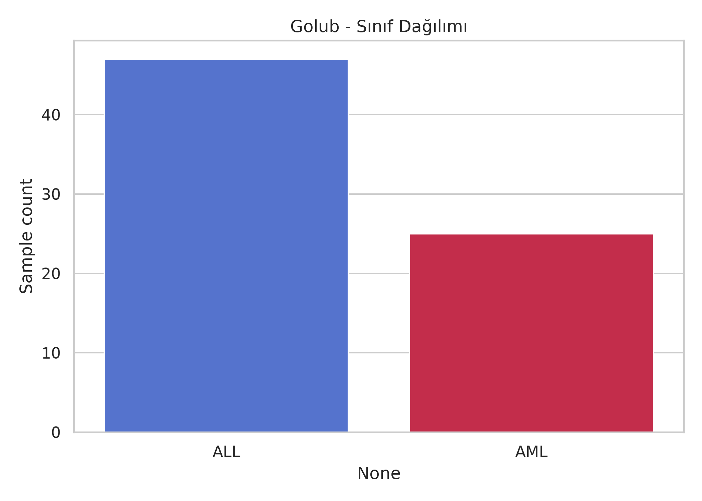
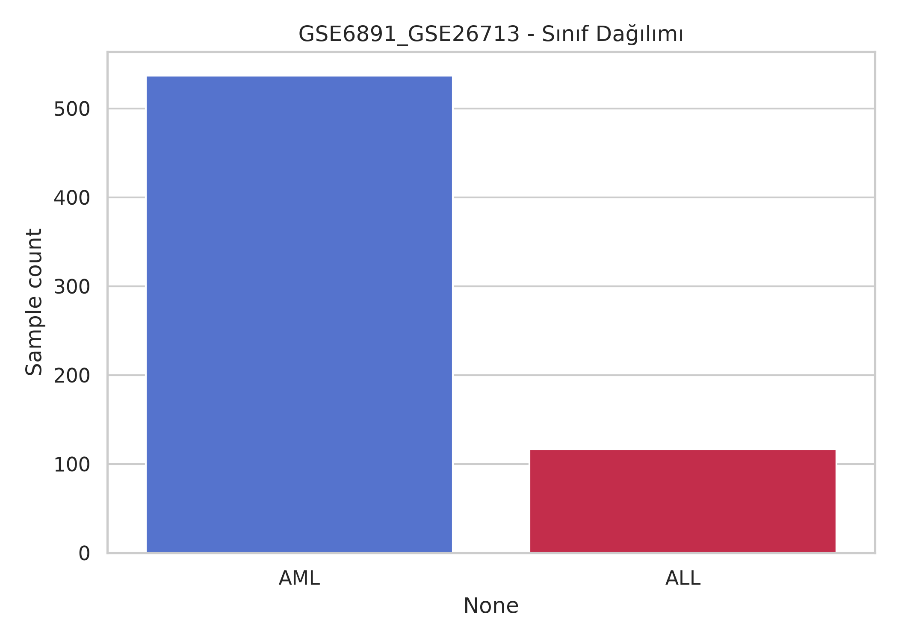
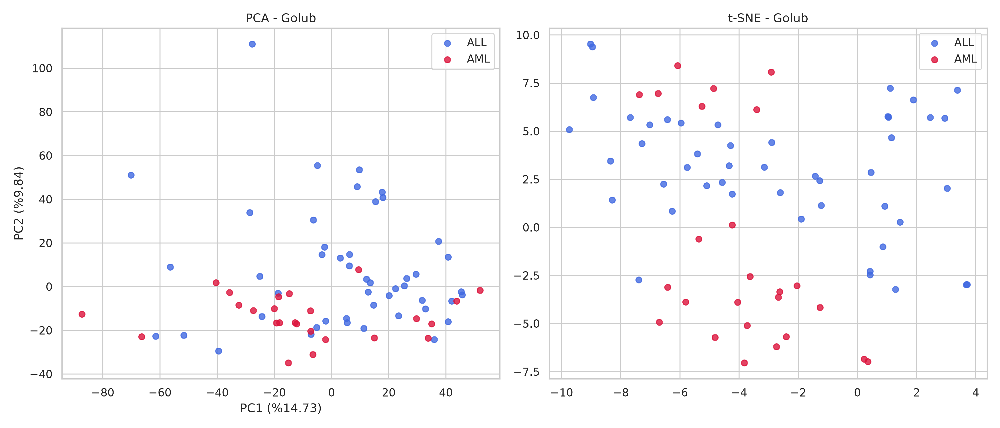
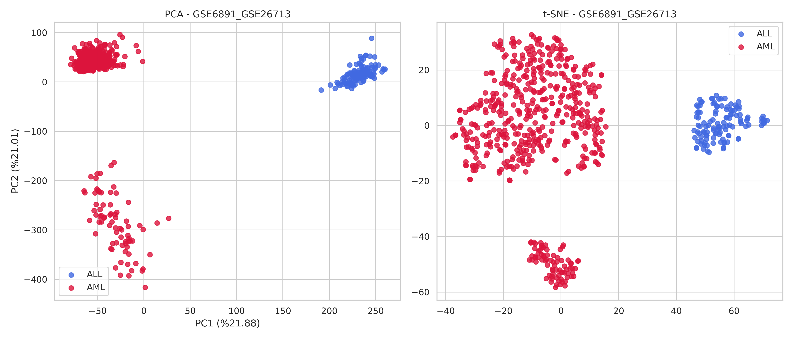
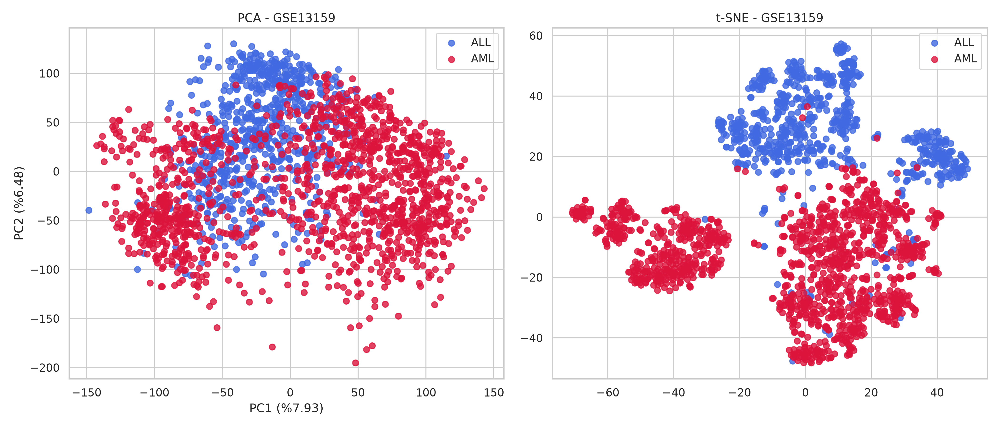

# Gen İfadesi Mikrodizi Verilerinden Lösemi Alt Tipi Sınıflandırmasında Platformlar Arası Keşifsel Analiz

[](https://python.org)
[](https://nih.gov)

Bu proje, yüksek boyutlu biyolojik verilerde (mikrodizi) makine öğrenmesi modellerinin sınırlarını, **veri sızıntısız (data leakage-free)** öznitelik seçimi süreçlerini ve farklı jenerasyon cihaz platformları arasındaki **teknik yığın etkisini (batch effect)** sistematik olarak sorgulayan uçtan uca tekrarlanabilir bir iş akışıdır.

## 📌 Proje Özeti & Motivasyon

Klinik pratikte löseminin **Akut Lenfoblastik Lösemi (ALL)** ve **Akut Miyeloid Lösemi (AML)** olarak doğru alt tiplendirilmesi, uygulanacak kemoterapi rejimlerinin tamamen farklı olması sebebiyle hayati öneme sahiptir. Bu çalışmada, mikrodizi (microarray) gen ekspresyon verileri kullanılarak ALL ve AML alt tiplerinin sınıflandırılmasına yönelik uçtan uca, veri sızıntısız ve tekrarlanabilir bir makine öğrenmesi iş akışı geliştirilmiştir.

Çalışmanın ana motivasyonu, modellerin tek bir kohorttaki içsel başarısıyla yetinmeyip, farklı laboratuvarlar ve jenerasyon cihaz platformları (Affymetrix Hu6800 vs. HG U133 P2) arasındaki **batch etkisini ve platformlar arası genellenebilirliği** sistematik olarak araştırmaktır. 

- **Yüksek Boyutlu Veri Yönetimi:** Gen sayısının örnek sayısından çok daha fazla olduğu ($p \gg n$) ve aşırı öğrenme (overfitting) riski barındıran 6.263 gen probuna sahip Golub veri seti üzerinde çalışılmıştır.
- **Platformlar Arası Entegrasyon:** Farklı mikrodizi platformlarındaki prob anotasyonu ve gen isimlendirme farklılıkları, R programlama dili ve Bioconductor paketleri kullanılarak çözülmüş ve ortak gen havuzu başarıyla eşleştirilmiştir.
- **Gelişmiş Sınıflandırma Başarısı:** Küçük örneklem büyüklüğüne rağmen doğrusal ve topluluk (ensemble) tabanlı makine öğrenmesi modelleriyle ALL ve AML alt tipleri yüksek ayırt edici performansla sınıflandırılmıştır.
- **Model Karşılaştırmaları:** Bağımsız test sonuçlarında Lojistik Regresyon ve SVM modelleri %97,06 doğruluk (Accuracy) ve %96,93 F1-Macro skoruna ulaşırken, Random Forest modeli 0,9964 ROC-AUC değeriyle en yüksek ayırt edici performansı göstermiştir.

---

## 🔬 Metodoloji ve Veri Sızıntısı Koruması

Çalışmanın bilimsel doğruluğunu sağlamak, aşırı öğrenmeyi (overfitting) engellemek ve yüksek boyutlu verilerde ($p \gg n$) sıkça karşılaşılan **veri sızıntısı (data leakage)** riskini tamamen ortadan kaldırmak amacıyla tüm ön işleme ve modelleme adımları sıkı bir veri koruma iş akışı (Pipeline) mimarisiyle yürütülmüştür.

### 1. Prob Anotasyonu ve Platform Uyumlulaştırma (R & Bioconductor)
Farklı mikrodizi platformlarından (Affymetrix Hu6800 ve HG U133 P2) elde edilen gen ekspresyon verilerini karşılaştırılabilir kılmak adına ilk aşama R ortamında yürütülmüştür:
* **Anotasyon Paketleri:** Golub veri seti için `hu6800.db`, dış kohortlar (GSE6891, GSE26713, GSE13159) için ise `hgu133plus2.db` paketleri kullanılmıştır.
* **ID Eşleştirme:** `AnnotationDbi` kütüphanesi aracılığıyla platforma özgü Prob Kimlikleri (Probe ID), evrensel biyolojik Gen Sembollerine (Gene Symbol) dönüştürülmüştür. Geçerli karşılığı olmayan problar filtrelenmiş ve temizlenen anotasyon verileri Python analiz sürecine aktarılmıştır.

### 2. Sızıntısız Ön İşleme ve Özellik Seçimi (Python Pipeline)
Eksik değer tamamlama, ölçeklendirme ve boyut indirgeme işlemleri asla tüm veriye toplu olarak uygulanmamıştır. Modelin bağımsız test setleri üzerindeki dış genellenebilirliğini adil ölçebilmek için şu protokol izlenmiştir:
* **Eğitim ve Test Ayrımı:** Golub veri seti 38 örneklik eğitim (Train) ve 34 örneklik bağımsız test (Test) bölümü olarak ikiye ayrılmıştır.
* **İçsel Parametre Öğrenimi:** Medyan tabanlı eksik veri tamamlama (`SimpleImputer`), ANOVA F-testi tabanlı en iyi 200 genin seçilmesi (`SelectKBest`) ve standartlaştırma (`StandardScaler`) işlemleri **yalnızca eğitim kümesi üzerinde fit edilmiş**; bağımsız test kümesine ise bu parametreler sadece tatbik (`transform`) edilmiştir.
* **Sınıf Dengesizliği Yönetimi:** Veri setlerindeki ALL ve AML sınıflarının dengesiz dağılımına karşı tüm makine öğrenmesi modellerinde `class_weight='balanced'` cezalandırma parametresi aktif edilmiştir.

### 3. Keşifsel Veri Analizi ve Boyut İndirgeme
Yüksek boyutlu öznitelik uzayının sınıfsal ayrım gücü ve veri setleri arasındaki teknik varyasyonlar (batch effect) **Temel Bileşenler Analizi (PCA)** ve **t-SNE** algoritmalarıyla incelenmiştir. Ek olarak, ANOVA ile seçilen en ayırt edici genlerin ALL ve AML kohortlarındaki zıt ekspresyon örüntüleri **Ward yöntemi tabanlı hiyerarşik kümeleme ısı haritaları (Clustermap)** ile doğrulanmıştır.

---

## 🔄 Tekrarlanabilirlik 

Bu projedeki analizlerin ve model sonuçlarının her çalıştırıldığında birebir aynı çıkması (tekrarlanabilir olması) için sabit bir random seed kullanılmıştır. 

- **Random Seed:** `42`

Projedeki veri bölme (train/test split) ve model eğitim süreçlerinde bu sabit değer kullanılarak sonuçların kararlılığı garanti altına alınmıştır.

## 📊 Veri Setleri Künyesi

Projede kullanılan tüm veri setleri, biyolojik bağlamları, örnek boyutları ve R tabanlı anotasyon süreçleri sonrası genişletilen gen havuzlarıyla birlikte aşağıda özetlenmiştir. Modül dosyasındaki hatalı 'non-cancer' etiketi, biyolojik gerçekliğe uygun olarak **'ALL vs. AML alt tip sınıflandırması'** şeklinde düzeltilmiştir.

| Veri Seti | Cihaz / Platform | Boyutlar (Örnek / Gen) | Sınıf Dağılımı (%) | Rolü & Analiz Amacı |
| :--- | :--- | :---: | :---: | :--- |
| **Golub** | Affymetrix Hu6800 (GPL31) | 72 hasta, 6.263 gen | %65.3 ALL / %34.7 AML | Ana Kohort (Eğitim: 38 / Bağımsız Test: 34) |
| **GSE6891 & GSE26713**<br>*(Birleşik Dış Kohort)* | Affymetrix HG U133 P2 (GPL570) | 654 hasta, 54.675 gen | %17.9 ALL / %82.1 AML | Bağımsız Dış Değerlendirme Seti 1 (Dikey Birleşik) |
| **GSE13159 (MILE)** | Affymetrix HG U133 P2 (GPL570) | 2.096 hasta, 54.675 gen | %35.8 ALL / %64.2 AML | Bağımsız Dış Değerlendirme Seti 2 |

### 🔀 Sınıf Dağılımı

#### 1. Golub 


#### 2. GSE6891_GSE26713 


#### 3. GSE13159 - MILE 


### 🔄 Birleşik Dış Kohort Oluşturma Stratejisi
* **Hastalık Dağılımı:** GSE6891 veri seti yoğun olarak AML örneklerini, GSE26713 veri seti ise pediatrik T-ALL örneklerini içerdiği için, her iki hastalık alt tipini dengeli bir şekilde kapsayan tamamen bağımsız bir dış değerlendirme gücü elde etmek amacıyla birleştirilmiştir.
* **Dikey Birleştirme:** İki farklı çalışmadan gelen matrislerin öncelikle ortak gen kümesi (özellik uzayı) belirlenmiş, ardından yalnızca bu eşleşen genlerden oluşan özellik matrisleri örnekler bazında dikey (vertical row bind) olarak birleştirilerek **654 örnekli tek bir dev kohort** haline getirilmiştir.

---

## 📈 Deneysel Sonuçlar

### 📊 Boyut İndirgeme ve Kümeleme Grafikleri

#### 1. Golub Kohortu (Eğitim & İç Doğrulama Seti)


#### 2. GSE6891_GSE26713 (Bağımsız Dış Test Seti 1)


#### 3. GSE13159 - MILE (Bağımsız Dış Test Seti 2)


### 1. İç Doğrulama Performansı (Golub Kohortu)
* **Random Forest:** %91.2 Accuracy | %90.1 F1(Macro) | 0.996 ROC-AUC
* **Logistic Regression:** %97.1 Accuracy | %96.9 F1(Macro) | 0.993 ROC-AUC
* **Support Vector Machine:** %97.1 Accuracy | %96.9 F1(Macro) | 0.993 ROC-AUC
* **Decision Tree (En Zayıf):** %91.2 Accuracy | %91.0 F1(Macro) | 0.912 ROC-AUC

---

## 🛠️ Klasör Yapısı

```text
├── Annotations/       # R ile çekilen ve gen tanımlayıcıları (ID/Probe) ile eşleştirilen açıklama verileri 
├── Datasets/          # NCBI GEO'dan alınan ham/işlenmiş veriler (Git'e push edilmez)
├── Outputs/           # PCA, t-SNE, Clustermap ve Karar Ağacı görsel çıktıları
├── References/        # Literatür taraması tam metin PDF arşivi (2021-2026)
├── Src/               # Modüler kaynak kodlar (Preprocessing, Feature Selection, vb.)
├── .gitignore         # Büyük veri dosyalarının repoyu kirletmesini engeller
├── README.md          # Proje ana dökümantasyonu
└── requirements.txt   # Proje kütüphane bağımlılıkları ve versiyonları
```

---

## 💻 Kurulum ve Çalıştırma

1. Projeyi yerelinize klonlayın:
   ```bash
   git clone https://github.com/GokhanArslanPostgraduate/MachineLearning.git
   cd MachineLearning
   ```

2. Gerekli kütüphaneleri yükleyin (Önerilen: Sabit sonuçlar için Python 3.9+):
   ```bash
   pip install -r requirements.txt
   ```

3. Analiz boru hattını (pipeline) çalıştırın:
   ```bash
   python Src/main.py
   ```

---

## 🚀 Final Dönemi Yol Haritası (Gelecek Çalışmalar)

Ara raporda saptanan platform bariyerini aşarak bağımsız kohortlardaki tahmin başarısını stabilize etmek amacıyla şu adımlar entegre edilmektedir:

1. **R ve Bioconductor Tabanlı Dinamik Annotasyon:** Projenin R ayağında `AnnotationDbi` paketleri (`hu6800.db` ve `hgu133plus2.db`) ile hazırlanan prob-gen sembolü eşleştirme tabloları Python hattına dinamik olarak bağlanacaktır. Böylece platformlar arası ortak gen havuzunun kritik sınırın üzerine çıkarılması güvenceye alınacaktır.
2. **Dağılımsal Heterojenlik ve Batch Düzeltmesi:** Sinyal yoğunluğu ve EDA analizlerinde tespit edilen platformlar arası ölçek farklılıklarını (MAS5 / RMA normalizasyon kaymaları) ve olası laboratuvar kaynaklı teknik yığın etkilerini gidermek amacıyla boru hattına `ComBat` düzeltme mimarisi dahil edilecektir.
3. **Uçtan Uca Dış Doğrulama ve Genellenebilirlik Testi:** Ön işleme ve batch düzeltme süreçleri tamamlandıktan sonra, Golub kohortunda eğitilen 4 temel model (Random Forest, Lojistik Regresyon, SVM, Karar Ağacı) bağımsız dış kohortlar (GSE6891_GSE26713 ve GSE13159) üzerinde yeniden koşturulacaktır.
4. **Metrik Tabanlı Çapraz Kontrol:** Modellerin dış dünyaya genellenebilirliği; iç doğrulama bulgularıyla karşılaştırmalı olarak **Accuracy, F1-Macro ve ROC-AUC** metrikleri üzerinden çok boyutlu şekilde valide edilecektir.

---

## ✍️ Yazar & İletişim

* **Yasin Gökhan Arslan** - [GitHub](https://github.com/GokhanArslanPostgraduate)
* **Ders Bilgisi:** 503001508 – Makine Öğrenmesi ve Anomali Tespiti

## 📑 Atıf (Citation)
Bu çalışmayı akademik araştırmalarınızda kullanırsanız lütfen aşağıdaki şekilde atıfta bulununuz:
```text
Arslan, Y. G. (2026). Gen İfadesi Mikrodizi Verilerinden Lösemi Alt Tipi Sınıflandırmasında Platformlar Arası Keşifsel Analiz. Eskişehir Osmangazi Üniversitesi, Makine Öğrenmesi ve Anomali Tespiti Dersi Dönem Projesi. GitHub: GokhanArslanPostgraduate/MachineLearning